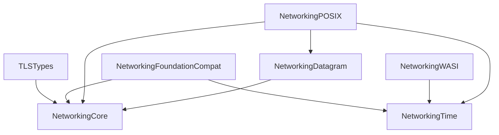

# Repository Architecture Rules

## Purpose

`swift-networking` is the protocol-neutral foundation package shared by Native,
WebAssembly, and Embedded Swift networking libraries. It owns common values,
ownership contracts, time abstractions, datagram I/O contracts, narrow platform
adapters, and TLS vocabulary.

It is not a high-level networking framework. It must not grow connection
orchestration, application sessions, protocol state machines, cryptography, or
wire formats merely because several consumers need them.

The package is a shared compatibility and release baseline. Its products remain
separate modules with separate responsibilities. There is no umbrella module,
and consumers import only the capabilities they require.

## Package Cohesion

- `NetworkingCore`, `NetworkingTime`, `NetworkingDatagram`, `NetworkingPOSIX`,
  `NetworkingWASI`, `NetworkingFoundationCompat`, and `TLSTypes` ship from this
  repository and version together.
- Keeping products in one package does not permit cross-module responsibility
  leakage. Package cohesion is a distribution decision; module boundaries are
  compile-time architecture boundaries.
- `TLSTypes` remains in this package because it is shared vocabulary that must
  use the same portable byte and platform baseline. Its TLS-specific meaning is
  isolated in its own module and does not make the other modules TLS-aware.
- Do not split a foundation module into a separate package without an
  independently justified ownership, release, or dependency boundary.
- Do not add an external runtime dependency such as SwiftNIO to this foundation
  package merely to provide an adapter. Runtime integrations remain outside the
  package unless their dependency and release coupling is explicitly adopted as
  part of this package's responsibility.

## Dependency Direction



- Dependencies point from adapters and specialized vocabulary toward the
  smallest protocol-neutral contracts.
- `NetworkingCore` and `NetworkingTime` must not depend on platform adapters,
  Foundation compatibility, TLS vocabulary, or protocol packages.
- `NetworkingDatagram` defines the I/O contract and must not depend on a socket
  implementation.
- Platform modules implement shared contracts; shared contracts never import a
  platform module.
- Do not introduce dependency cycles or an umbrella target to hide them.

## Module Responsibilities

| Module | Owns | Must not own |
|---|---|---|
| `NetworkingCore` | Owned contiguous bytes, scoped byte borrows, bounded protocol-neutral cursors/builders, endian primitives, numeric IP addresses, and socket endpoints | Foundation types, clocks, I/O, protocol wire formats, cryptography, DNS resolution, TLS, QUIC, STUN, or application sessions |
| `NetworkingTime` | Monotonic instants, Unix instants, deadlines, and injectable clock/timer protocols | Platform syscalls, certificate policy, retransmission policy, or protocol timeouts |
| `NetworkingDatagram` | Transport-independent owned datagram payloads, metadata, buffering policy, capabilities, statistics, cancellation, failure, and shutdown contracts | POSIX/NIO/WASI sockets, QUIC packets, DNS messages, STUN messages, or connection demultiplexing |
| `NetworkingPOSIX` | POSIX UDP, multicast, monotonic/wall clocks, and timers that implement shared contracts | Protocol parsing, application lifecycle, SwiftNIO abstractions, or portable fallback behavior |
| `NetworkingWASI` | WASI clock and cancellation-aware timer implementations | Invented UDP support, POSIX compatibility shims, or silent fallback for unavailable capabilities |
| `NetworkingFoundationCompat` | Explicit bridges between Foundation values and networking values | Foundation types in core APIs, hidden storage sharing, or Foundation as a portable requirement |
| `TLSTypes` | Stable TLS vocabulary such as role, version, cipher suite, encryption level, ALPN, alert, and server name | Secrets, key material, records, wire parsing, handshake state, PKI, certificate validation, TLS engines, or session orchestration |

## Protocol Package Boundaries

Protocol behavior remains with the package that owns that protocol:

| Responsibility | Owning package |
|---|---|
| Cryptographic primitives, DER, X.509/PKI, TLS and DTLS mechanisms | `swift-ssl` |
| TLS, DTLS, and QUIC TLS session state and orchestration | `swift-tls` |
| QUIC wire format, recovery, streams, connection state, and UDP demultiplexing | `swift-quic` |
| DNS and mDNS wire formats and discovery behavior | `swift-mDNS` |
| STUN, ICE, DTLS-SRTP, SCTP, RTP, and WebRTC session behavior | `swift-webrtc` |
| Peer identity, multiaddress, negotiation, transports, muxing, and peer sessions | `swift-libp2p` |

Shared use by two or more protocol packages is not sufficient reason to move a
type into `swift-networking`. A type belongs here only when its meaning is
protocol-neutral or when it is deliberately part of the bounded `TLSTypes`
vocabulary module.

## Type Placement Decision

Before adding or moving a public type, answer these questions in order:

1. What domain meaning does the type express, and which package owns that
   meaning?
2. Who creates it, who retains it, who consumes it, and how long does it live?
3. Is it a value/contract shared independently of a protocol, or does it encode
   protocol behavior or wire semantics?
4. Does it require Foundation, POSIX, WASI, SwiftNIO, cryptography, or another
   platform/runtime capability?
5. Can an existing module own it without reversing a dependency or weakening an
   ownership, failure, or platform contract?

Use the following placement rules:

- Put protocol-neutral values and bounded byte operations in `NetworkingCore`.
- Put time values and injectable time contracts in `NetworkingTime`.
- Put only transport-independent asynchronous datagram contracts in
  `NetworkingDatagram`.
- Put concrete system calls and runtime-specific behavior in the corresponding
  platform adapter.
- Put explicit Foundation conversion in `NetworkingFoundationCompat`.
- Put TLS vocabulary in `TLSTypes` only when the type carries no secret,
  mechanism, parsing, validation, state-machine, or session responsibility.
- Keep protocol codecs, policies, and state machines in their protocol package.
- If ownership remains ambiguous, do not add the public API until the complete
  construction-to-destruction path has been traced.

## Interface and Implementation Separation

- Public runtime dependencies are small protocols owned by the module that
  consumes the capability.
- Concrete system implementations live in adapter modules and are injected at
  the platform composition boundary.
- Do not expose POSIX descriptors, Foundation storage, WASI handles, or another
  runtime's buffer type through portable contracts.
- A platform module must report an unavailable capability with a typed failure;
  it must not silently substitute different semantics.
- Public errors distinguish clean shutdown, cancellation, unsupported
  capability, invalid input, and backend failure when callers must react
  differently.

## Ownership and Data Path Contract

```text
synchronous parse or encode
    OwnedBytes --scoped borrow--> Span<UInt8>

asynchronous datagram I/O
    caller --consuming--> OwnedBytes --ownership transfer--> transport
```

- Owned and borrowed byte types must have distinct names and contracts.
- A `Span`, buffer pointer, or other borrowed view must not escape its owner or
  cross an `await` boundary.
- Asynchronous APIs accept or return owned storage.
- Hot paths use one storage owner plus bounded views and avoid repeated
  materialization into `Array`, `Data`, or `String`.
- A required copy occurs once at an explicit compatibility or ownership
  boundary and is documented when it affects a repeated data path.
- Unsafe operations remain internal, scoped, and backed by explicit owner,
  lifetime, bounds, alignment, initialization, and deallocation invariants.

## Datagram Lifecycle Contract

- A `DatagramTransport` has reference identity and owns one I/O lifecycle.
- Exactly one `receive()` may be active for each transport.
- A concurrent receive reports `DatagramError.concurrentReceive`.
- Cancelling a receive does not close the transport.
- `nil` means clean shutdown; backend failures are thrown.
- Repeated or concurrent `shutdown()` calls join the same terminal result.
- Independent protocol connections use independent transports unless a single
  demultiplexer owns the only receive loop and routes packets to connections.
- Network I/O, `await`, event emission, and external callbacks do not execute
  while a mutex is held.

## Platform Contract

- Native, standard WASM, and Embedded WASM share the same public ownership,
  `Sendable`, synchronization, and failure semantics.
- Conditional compilation reflects a real platform capability difference; it
  must not weaken a shared contract.
- Shared mutable state uses the same actor or `Mutex<State>` isolation model on
  every target where that state is reachable.
- Foundation and POSIX availability are explicit capabilities, not assumptions
  made by protocol-neutral modules.
- Build success alone is not runtime evidence. Exercise real socket behavior on
  Native platforms and compile the complete portable graph with the pinned WASM
  and Embedded WASM SDKs.

## Change Review Requirements

For a change that affects module boundaries or public API, document and verify:

1. The current package/module dependency graph and all affected callers.
2. The end-to-end data and execution path, including ownership, lifetime,
   isolation, shutdown, and failure behavior.
3. Why the selected module owns the responsibility and why adjacent modules do
   not.
4. Success, failure, cancellation, concurrency, and platform-specific behavior
   in tests where applicable.
5. Native `xcodebuild` tests and the affected standard/Embedded WASM build
   lanes.

Do not treat a declaration, type-check, empty fixture, constant result, or
compile-only test as proof that the implementation path works.
