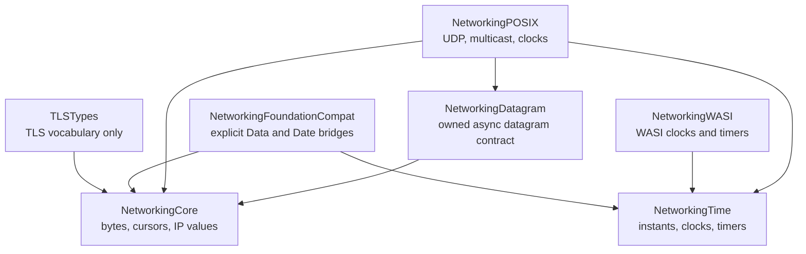

# swift-networking

Protocol-neutral networking foundations for Native, WebAssembly, and Embedded
Swift.

`swift-networking` provides the small set of value types, ownership contracts,
time abstractions, and platform adapters shared by protocol implementations such
as `swift-ssl`, `swift-tls`, `swift-quic`, `swift-webrtc`, `swift-mDNS`, and
`swift-libp2p`.

It is not a high-level networking framework and does not replace Apple's
`Network` framework. It contains no HTTP client, connection orchestration, TLS
handshake, QUIC state machine, DNS codec, or application session API.

## Design

The package intentionally has no umbrella module. Consumers import only the
capability they own, keeping protocol code independent from platform adapters.



The modules have distinct responsibilities but share one package because they
form a single compatibility baseline and release together. Module boundaries
still prevent Foundation, POSIX, WASI, or TLS vocabulary from leaking into
protocol-neutral code.

## Products

| Product | Owns | Does not own |
|---|---|---|
| `NetworkingCore` | `OwnedBytes`, scoped `Span` borrows, bounded byte cursors/builders, numeric IP addresses and endpoints | Protocol wire formats, cryptography, I/O |
| `NetworkingTime` | Monotonic and wall-clock values plus injectable clock/timer contracts | Platform syscalls, certificate or TLS policy |
| `NetworkingDatagram` | Payload ownership, cancellation, buffering, metadata, capabilities, statistics, and shutdown contracts | Socket implementation, QUIC, DNS, or STUN framing |
| `NetworkingPOSIX` | POSIX UDP/multicast and clock/timer implementations | SwiftNIO, application lifecycle, protocol state machines |
| `NetworkingWASI` | WASI clock and cancellation-aware timer implementations | UDP or multicast unavailable in WASI Preview 1 |
| `NetworkingFoundationCompat` | Explicit `Data`/`OwnedBytes` and `Date`/`UnixInstant` copies | Foundation in core APIs or Embedded Swift |
| `TLSTypes` | TLS role, version, cipher suite, encryption level, ALPN, alert, and server-name vocabulary | Secrets, records, wire parsing, handshake state, PKI |

Protocol-specific codecs remain in their protocol packages:

- TLS and DTLS wire formats belong to `swift-ssl`.
- TLS, DTLS, and QUIC TLS sessions belong to `swift-tls`.
- QUIC packets and connection state belong to `swift-quic`.
- DNS and mDNS wire formats belong to `swift-mDNS`.
- STUN, DTLS-SRTP, SCTP, and RTP belong to `swift-webrtc`.

## Ownership model

The hot-path contract separates synchronous borrowing from asynchronous
ownership:

```text
synchronous parse or encode
    OwnedBytes --scoped borrow--> Span<UInt8>

asynchronous datagram I/O
    caller --consuming--> OwnedBytes --ownership transfer--> transport
```

- `OwnedBytes` owns immutable contiguous storage.
- `ByteCursor` borrows a `Span<UInt8>` and cannot escape its source lifetime.
- A borrowed pointer or `Span` never crosses an `await` boundary.
- `DatagramTransport.send` consumes an owned payload.
- `InboundDatagram` owns its received payload.
- POSIX receive writes into the buffer that becomes the final `OwnedBytes`
  owner; it does not materialize a second payload buffer.
- Foundation bridges are explicit copies because Foundation and
  `NetworkingCore` have different storage owners.

## Datagram contract

`DatagramTransport` is a reference-identity I/O lifecycle. Its behavioral
contract is intentionally strict:

- Exactly one `receive()` may be active per transport.
- A concurrent receive throws `DatagramError.concurrentReceive`.
- Cancelling a receive does not close the transport.
- `nil` means clean shutdown; backend failures are thrown.
- Repeated and concurrent `shutdown()` calls join the same terminal result.
- Overflow behavior is selected explicitly: drop newest, drop oldest, or fail
  the transport.
- Optional send metadata is rejected before I/O when a backend lacks the
  required capability.

Independent protocol connections must use independent transports unless a
single demultiplexer owns the only receive loop.

## Platform support

| Product | Native Darwin/Linux | WASI | Embedded WASM |
|---|---:|---:|---:|
| `NetworkingCore` | Yes | Yes | Yes |
| `NetworkingTime` | Yes | Yes | Yes |
| `NetworkingDatagram` | Yes | Yes | Yes |
| `NetworkingPOSIX` | Darwin, Glibc, Musl | No public POSIX API | No public POSIX API |
| `NetworkingWASI` | No public WASI API | Yes | Yes |
| `NetworkingFoundationCompat` | When Foundation is available | No public API | No public API |
| `TLSTypes` | Yes | Yes | Yes |

Platform-specific source is capability-gated. The shared modules keep the same
ownership, `Sendable`, and failure contracts across Native, WASM, and Embedded
builds.

## Requirements

The current baseline is pinned because the package uses Swift 6.4 ownership and
lifetime features:

- Swift `swift-6.4.x-DEVELOPMENT-SNAPSHOT-2026-07-23-a`
- Compiler commit `ef761e567dc94ee`
- Matching standard and Embedded WebAssembly SDKs from the same snapshot
- macOS 26+ or iOS 26+ for declared Apple platform deployment targets

## Installation

Until the first semantic-versioned release is tagged, depend on `main`:

```swift
dependencies: [
    .package(
        url: "https://github.com/1amageek/swift-networking.git",
        branch: "main"
    )
]
```

Select only the products required by the target:

```swift
.target(
    name: "ProtocolRuntime",
    dependencies: [
        .product(name: "NetworkingCore", package: "swift-networking"),
        .product(name: "NetworkingTime", package: "swift-networking"),
        .product(name: "NetworkingDatagram", package: "swift-networking"),
    ]
)
```

## Usage

Parse numeric endpoints without Foundation or DNS resolution:

```swift
import NetworkingCore

if let address = IPAddress(parsing: "2001:db8::1"),
   case let .v6(ipv6) = address {
    let endpoint = IPSocketEndpoint(ipv6: ipv6, port: 443)
    print(endpoint.address.textRepresentation)
}
```

Create a bounded POSIX UDP transport with explicit receive overflow behavior:

```swift
import NetworkingCore
import NetworkingDatagram
import NetworkingPOSIX

let buffering = try DatagramReceiveBuffering(
    capacity: 64,
    overflowPolicy: .dropOldest
)
let transport = try POSIXDatagramTransport(
    bindingTo: IPSocketEndpoint(ipv4: 0, 0, 0, 0, port: 0),
    receiveBuffering: buffering
)

if let datagram = try await transport.receive() {
    datagram.payload.withBorrowedBytes { bytes in
        print("Received \(bytes.count) bytes from \(datagram.source)")
    }
}

try await transport.shutdown()
```

Applications normally inject `DatagramTransport`, `AsyncTimer`, `MonotonicClock`,
or `WallClock` protocols and construct `NetworkingPOSIX`/`NetworkingWASI`
implementations only at the platform composition boundary.

## Validation

Run the Native test suite with the pinned toolchain and a bounded timeout:

```bash
task_swiftc="$(xcrun --toolchain org.swift.64202607231a --find swiftc)"
task_toolchain_root="${task_swiftc%/usr/bin/swiftc}"

TOOLCHAINS=org.swift.64202607231a \
  perl -e 'alarm shift; exec @ARGV' 1200 \
  xcodebuild test \
    -scheme swift-networking-Package \
    -destination 'platform=macOS' \
    -parallel-testing-enabled NO \
    "LD_RUNPATH_SEARCH_PATHS=\$(inherited) $task_toolchain_root/usr/lib/swift/macosx/testing"
```

Build the portable package graph with the matching SDKs:

```bash
swift build \
  --swift-sdk swift-6.4.x-DEVELOPMENT-SNAPSHOT-2026-07-23-a_wasm \
  --configuration release

swift build \
  --swift-sdk swift-6.4.x-DEVELOPMENT-SNAPSHOT-2026-07-23-a_wasm-embedded \
  --configuration release
```

CI performs the Native test suite and both WebAssembly build lanes with the
same pinned compiler commit.
